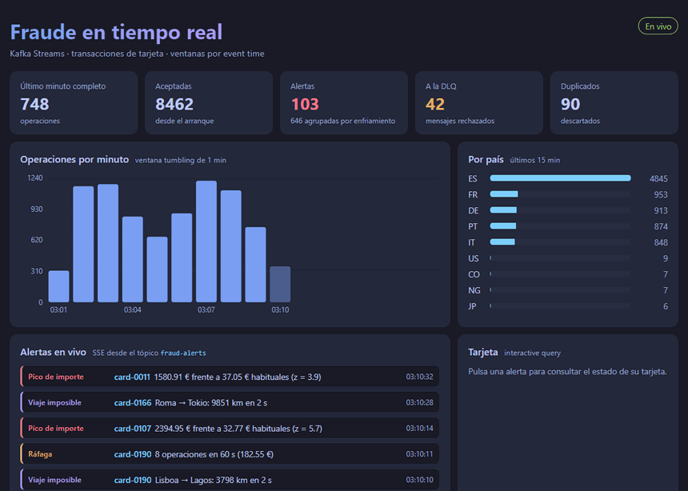
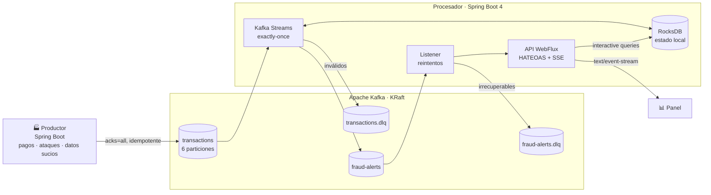
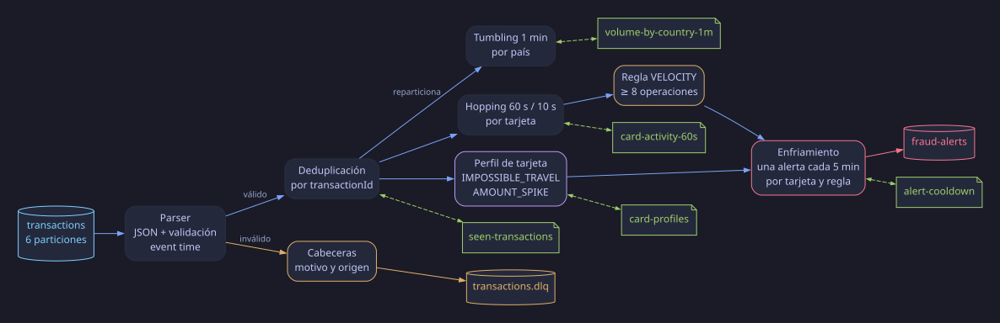
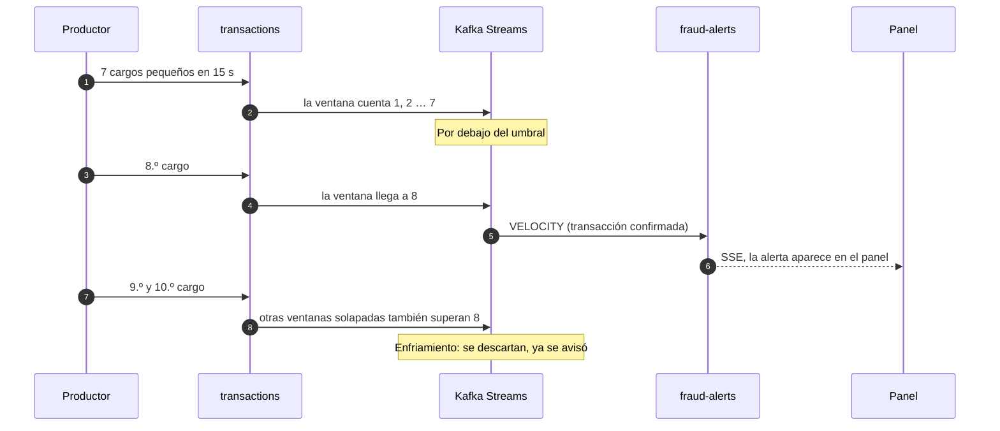

<p align="center">
  
</p>

<p align="center">
  <a href="https://github.com/AlbaAsca/realtime-fraud-pipeline/actions/workflows/ci.yml"></a>
  
  
  
  
  
</p>

<p align="center">
  <b>Detección de fraude con tarjetas mientras el ataque está ocurriendo.</b><br>
  Ventanas por event time · reglas con estado · exactly-once · DLQ · panel en vivo. Se levanta con un solo comando.
</p>

> 🇬🇧 **In English:** a real-time card-fraud detection pipeline. A Java producer streams realistic transactions, including
> attacks and dirty data, into Apache Kafka (KRaft). A Spring Boot 4 + Kafka Streams topology validates and deduplicates them,
> aggregates tumbling and hopping event-time windows, applies three stateful fraud rules with exactly-once semantics, and
> publishes alerts to a topic. A WebFlux API serves interactive queries over the local state and streams alerts to a live
> dashboard via Server-Sent Events. Poison messages go to a DLQ. Tested with `TopologyTestDriver` and an end-to-end
> Testcontainers suite against a real broker in CI. Runs locally with `docker compose up`, at zero cost.

## El problema

Un proceso batch nocturno detecta el fraude cuando el dinero ya se ha ido. Quien roba tarjetas lo sabe, y por eso actúa
en minutos: prueba decenas de cargos pequeños para ver cuáles siguen vivas y luego las vacía.

Detectarlo a tiempo parece fácil («cuenta las operaciones del último minuto»), pero en un sistema real aparecen los problemas
de verdad, y son los que resuelve este proyecto:

| Lo que pasa en producción | Qué lo resuelve aquí |
|---|---|
| Los eventos **llegan tarde y desordenados** | Ventanas por *event time* con periodo de gracia |
| El emisor **reintenta y duplica** pagos | Deduplicación por `transactionId` con estado que caduca solo |
| Llega un **mensaje corrupto** | Va a una DLQ con el motivo; el pipeline ni se entera |
| Una instancia **se cae a mitad** | Exactly-once (`exactly_once_v2`) y estado recuperable desde Kafka |
| Una ráfaga cae en **varias ventanas solapadas** | Enfriamiento: una sola alerta, no seis |
| Un analista quiere **ver una tarjeta ahora** | Interactive queries sobre el estado, sin base de datos aparte |

## El panel en vivo

<p align="center">
  
</p>

<p align="center"><sub>GIF acelerado, con un ataque cada 6 s para la demo (por defecto, cada 20 s). Los datos son del generador, sin retoques.</sub></p>

En mi PC, con todo en Docker, una alerta tarda una **mediana de 126 ms** desde el instante del pago que la dispara hasta el
navegador (48 alertas, 15 pagos/s). Es una medida de andar por casa, no un benchmark: la hace [`capture_demo.py`](docs/capture_demo.py). Hubo un máximo de 20 s, seguramente
un pago que el generador marca con retraso a propósito y que ya nace viejo; no lo he comprobado una a una.

Las **alertas** llegan por SSE desde `fraud-alerts`. Los **contadores y gráficas** salen del estado de Kafka Streams. Al **pulsar
una alerta** se consulta en ese momento el estado de la tarjeta (interactive query).

## Por qué transacciones de tarjeta

Podría haber sido IoT, pero el fraude aprovecha mejor cada pieza del stream processing y se entiende sin explicar el dominio:

- **Clave natural** (`cardId`): orden por tarjeta y estado local por partición.
- **Ventanas con sentido**: la velocidad de gasto *es* una ventana solapada; el volumen por minuto, una fija.
- **Estado de verdad**: «¿dónde estuvo esta tarjeta hace un momento?» no se responde con una ventana.
- **El error cuesta dinero**: los duplicados y el desorden tienen consecuencias que se ven.

## Arquitectura



Por dentro, la topología de Kafka Streams es esta (en verde, los almacenes de estado):

<p align="center">
  
</p>

### Las tres reglas

| Regla | Qué detecta | Cómo | Dónde vive |
|---|---|---|---|
| 🟡 **`VELOCITY`** | Prueba de tarjetas robadas | ≥ 8 operaciones en 60 s | Ventana **hopping** 60 s / 10 s |
| 🟣 **`IMPOSSIBLE_TRAVEL`** | Tarjeta clonada | ≥ 500 km y > 1.000 km/h entre dos pagos **presenciales** | Estado por tarjeta |
| 🔴 **`AMOUNT_SPIKE`** | Vaciado de la tarjeta | Puntuación z ≥ 3,5 sobre el logaritmo del importe, ≥ 300 € y ≥ 5 pagos de historial | Estado por tarjeta (Welford) |

Los umbrales están en [`application.yaml`](processor/src/main/resources/application.yaml). Son plausibles, no calibrados:
ver [limitaciones](#limitaciones-y-siguientes-pasos).

### Un ataque, de principio a fin



## Cómo ejecutarlo

Solo necesitas Docker.

```bash
docker compose up --build
```

Abre <http://localhost:8080>. La primera alerta llega en torno a un minuto, y `AMOUNT_SPIKE` tarda unos minutos más
porque necesita tarjetas con historial.

| Otras formas | |
|---|---|
| Más ataques para la demo | `GENERATOR_ATTACK_EVERY=6s docker compose up --build` |
| Más carga | `GENERATOR_TPS=200 docker compose up --build` |
| Alertas por terminal | `curl -N localhost:8080/api/alerts/events` |
| Ver la DLQ con el motivo | `docker compose exec kafka /opt/kafka/bin/kafka-console-consumer.sh --bootstrap-server localhost:9092 --topic transactions.dlq --from-beginning --property print.headers=true` |
| Desde el IDE o la terminal (solo Kafka en Docker, necesita Java 21) | `docker compose up kafka`, `./mvnw install -DskipTests` y `./mvnw -pl processor spring-boot:run` |
| Apagar y borrar los datos | `docker compose down -v` |

### La API

Solo lectura, en HAL: `GET /api` devuelve los enlaces a todo lo demás.

| Recurso | Qué devuelve |
|---|---|
| `GET /api/alerts?cardId=&limit=` | Últimas alertas, con enlaces a cada una y a su tarjeta |
| `GET /api/alerts/{alertId}` | Una alerta |
| `GET /api/alerts/events` | Alertas en vivo (SSE) |
| `GET /api/cards/{cardId}` | Estado de una tarjeta (**interactive query**) |
| `GET /api/stats` | Contadores y volumen por minuto y país |
| `GET /api/stats/events` | Lo mismo, cada 2 s (SSE) |

<details>
<summary>Ejemplo: <code>GET /api/cards/card-0423</code></summary>

```json
{
  "cardId": "card-0423",
  "transactionsLastWindow": 2,
  "amountLastWindowEur": 35.61,
  "historySize": 9,
  "usualAmountEur": 31.40,
  "lastCity": "Lagos",
  "lastCountry": "NG",
  "lastSeenAt": "2026-11-02T01:51:53Z",
  "_links": {
    "self":   { "href": "/api/cards/card-0423" },
    "alerts": { "href": "/api/alerts?cardId=card-0423" }
  }
}
```
</details>

<details>
<summary>Los eventos: <code>transactions</code> y <code>fraud-alerts</code></summary>

```json
{
  "transactionId": "8f14e45f-ceea-367a-a714-9a8a4d0c9c11",
  "cardId": "card-0423",
  "merchant": "Zara",
  "category": "fashion",
  "amountEur": 42.90,
  "channel": "POS",
  "country": "ES",
  "city": "Valencia",
  "latitude": 39.4699,
  "longitude": -0.3763,
  "occurredAt": "2026-11-02T01:51:51Z"
}
```

```json
{
  "alertId": "d5bf4319-0c7b-38c8-a0b6-1ae25b376390",
  "cardId": "card-0423",
  "rule": "IMPOSSIBLE_TRAVEL",
  "reason": "Valencia → Lagos: 3680 km en 2 s",
  "amountEur": 35.61,
  "country": "NG",
  "city": "Lagos",
  "occurredAt": "2026-11-02T01:51:53Z"
}
```

El contrato está en [`Transaction.java`](events/src/main/java/org/ascaso/fraudpipeline/events/Transaction.java): un `record` con
Bean Validation, compartido por productor y procesador.
</details>

## Decisiones y su porqué

| Decisión | Por qué | Lo que cuesta |
|---|---|---|
| **Kafka Streams** frente a Flink | Es una librería: un `jar` más, sin clúster aparte. Sobra para este estado por clave | Sin SQL ni *savepoints*; atado a Kafka |
| **JSON + Bean Validation** frente a Avro + Schema Registry | Se lee a simple vista y evita un servicio más. Los campos nuevos no rompen a nadie porque los desconocidos se ignoran | Nadie impide un cambio incompatible antes de publicar: con más equipos elegiría Avro |
| **La fuente lee bytes** y el parser nunca lanza | Un mensaje roto es un dato más que va a la DLQ intacto, con motivo y origen en cabeceras | Un paso más en la topología |
| **Event time** tomado del propio evento | Un pago no ocurre cuando llega a Kafka. El panel y las reglas no cambian si hay retraso | Hay que elegir un periodo de gracia: 30 s para las reglas, 1 min para el volumen |
| **Hopping** para `VELOCITY`, **tumbling** para el volumen | Con ventana fija, una ráfaga partida entre dos minutos no se detectaría; [hay un test](processor/src/test/java/org/ascaso/fraudpipeline/processor/topology/FraudTopologyTest.java) para eso | Cada evento escribe en 6 ventanas y hay que deduplicar alertas |
| **Enfriamiento** por tarjeta y regla | Seis avisos por una ráfaga entrenan al analista a ignorarlos | Durante 5 min no se avisa de un segundo ataque con la misma regla |
| **`exactly_once_v2`** | Una caída no duplica alertas ni descuadra contadores de negocio | Algo más de latencia; el tópico se lee con `read_committed` |
| **EOS y además deduplicación** | Protegen de cosas distintas: EOS cubre reintentos *dentro* de Kafka, pero si el emisor manda dos veces, son dos mensajes | Un almacén más, que caduca a los 20 min |
| **El importe sospechoso no entra en el perfil** | Si no, cada fraude subiría la media y haría pasar mejor al siguiente | Si el cliente cambia de hábitos, tarda más en adaptarse |
| **Logaritmo del importe** para la puntuación z | Los importes siguen una distribución log-normal: con la media normal, cualquier compra grande saltaría | Menos intuitivo de explicar |
| **`alertId` determinista** | Reprocesar el mismo hecho da el mismo id; quien consuma puede deduplicar | Nada |
| **Solo pagos presenciales** en `IMPOSSIBLE_TRAVEL` | Un pago online no dice dónde está la tarjeta, y sería una fábrica de falsos positivos | No detecta fraude online por ubicación |
| **`DefaultErrorHandler`** en el listener | Tres reintentos con espera creciente para lo transitorio; un JSON roto va directo a la DLQ, porque reintentar no lo arregla | — |

## Tests

```bash
./mvnw verify      # necesita Java 21 y Docker
./mvnw test        # solo los que no necesitan Docker
```

| Qué | Con qué | Ejemplos |
|---|---|---|
| **Topología** (29) | `TopologyTestDriver`: tiempo controlado, sin broker | Ráfaga que cruza un minuto, evento fuera de gracia, duplicados que no disparan alertas, mensaje venenoso, el fraude que no contamina el perfil |
| **API** (11) | `@WebFluxTest`, `StepVerifier` y Mockito | Enlaces HATEOAS, 503 con RFC 9457 durante un reequilibrio, SSE |
| **Generador** (6) | JUnit, con semilla fija | Tráfico reproducible, tarjetas estables entre reinicios, inyección de duplicados y mensajes rotos |
| **De punta a punta** (5) | **Testcontainers** con un Kafka real | Ráfaga → tópico → API y SSE, DLQ con cabeceras, listener que sobrevive a una alerta ilegible |

Además, el [CI](.github/workflows/ci.yml) construye las imágenes, levanta el `compose.yaml` completo y **espera a que el pipeline
detecte fraude de verdad**.

<details>
<summary>Dónde está cada cosa</summary>

```
events/      Contrato: Transaction, FraudAlert, tópicos
producer/    TrafficGenerator (tráfico, ataques, datos sucios) y TrafficPublisher
processor/
  topology/  FraudTopology y sus procesadores, sin Spring: el test ejecuta la misma topología
  api/       API WebFlux, interactive queries, listener de alertas
  config/    Infraestructura de Kafka Streams y del listener
  static/    Panel: HTML, CSS y JavaScript sin dependencias
```
</details>

## Limitaciones y siguientes pasos

Es un proyecto de portfolio, no un sistema antifraude. Lo que le falta y lo que haría a continuación:

- **Datos sintéticos.** Los umbrales son razonables, pero no están calibrados con fraude real, así que no tiene sentido hablar de
  precisión ni de cobertura. El siguiente paso útil sería medirlas con un dataset público etiquetado.
- **Un solo broker y una sola instancia.** Las interactive queries solo leen las particiones locales: con varias réplicas haría falta
  `queryMetadataForKey` y una llamada entre instancias. El histórico del panel, además, vive en memoria (500 alertas), se
  reconstruye leyendo el tópico al arrancar y no sobrevive a su retención.
- **Sin autenticación.** La API y Kafka van en abierto: es local. En serio llevaría OAuth2 en la API y mTLS o SASL en Kafka.
- **Reglas en código.** Para cambiarlas hay que desplegar. Un motor de reglas o un modelo servido encajarían mejor; un modelo además
  aprovecharía los agregados como *features*.
- **Los perfiles no caducan.** Una tarjeta inactiva ocupa estado para siempre. Con pocos cientos de tarjetas da igual, con millones
  no: añadiría TTL con un `punctuate`.
- **Sin evolución de esquema gestionada.** Avro con Schema Registry sería lo primero en cambiar si hubiera más consumidores.
- **Reprocesar la DLQ es manual.** Los mensajes guardan motivo y origen, pero no hay herramienta para reinyectarlos.
- **Métricas sin dashboard.** Los contadores salen por `/actuator/metrics`; faltan Prometheus y Grafana.

## Licencia

[MIT](LICENSE)
